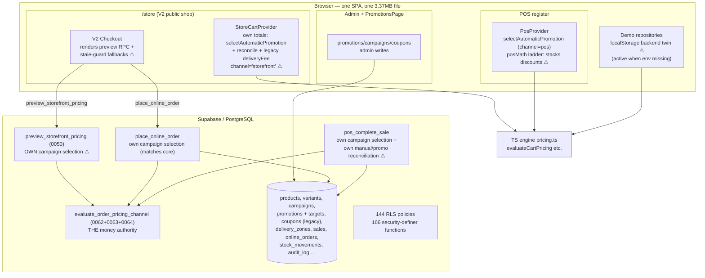
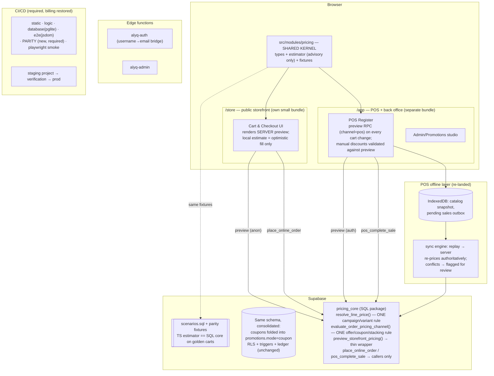

# ALYQ Cloud POS — Full Platform Audit & Engineering Plan

**Date:** 2026-09-28 · **Auditor:** Principal Engineering review (Arena Agent Mode)
**Scope:** entire repository at `main` = `ba6c60a` (PR #19 merge) · 151,677 LOC TS/TSX · 64 SQL migrations (28,959 LOC) · 29,000+ LOC of tests
**Method:** full read of the pricing/promotion critical path (TS + SQL), module-by-module survey, live execution of the complete verification suite (typecheck, logic suites, DB check on in-process PostgreSQL, production build).
**Status:** This document is the pre-implementation deliverable. **No code was changed.** Implementation begins only after approval (§12).

---

## 0. Executive summary

ALYQ Cloud POS is **not a rotten system — it is a good system with one structural disease**: the same business rules are implemented between five and seven times, in different languages, on different surfaces, with no equivalence test binding them together. Every incident in the project's recent history ("fixing one area broke another", pricing inconsistency, promotion conflicts, coupon problems, Cart vs Checkout differences, POS vs Online differences) is a symptom of that single disease:

> **A pricing/promotion rule that must hold in six places is written six times by hand, and nothing fails when the six copies drift apart.**

The evidence — collected in Part 1 — includes three *live*, reproducible divergences today (checkout preview vs. charged price; POS screen total vs. recorded sale total; cart channel filter vs. server channel filter), plus a red test suite on `main` that nobody saw because CI has been dead for billing reasons.

At the same time, the audit found **genuinely strong foundations** that a rebuild would foolishly discard: an idempotent, constraint-driven, RLS-complete PostgreSQL schema verified by a 6,761-line scenario suite running on an in-process real Postgres engine; server-authoritative money functions with row locks and idempotency keys; a bilingual type-checked dictionary; and a serious test culture (53 logic suites, 40 e2e flow scripts).

**The engineering decision (Part 10) is therefore: REFACTOR — with a disciplined rebuild of exactly two subsystems (the pricing engine, and the public storefront's delivery vehicle).** Not a wholesale rebuild, and absolutely not more patching.

The plan: one SQL pricing core as the single money authority, one TypeScript estimator clearly labeled advisory, a golden-fixture **parity test harness** that runs the same carts through both and fails CI on any difference, deletion of the surplus engines, re-landing of offline-first on top of the unified engine, and a split storefront bundle.

---

# PART 1 — COMPLETE SYSTEM AUDIT (Phase 1)

### 1.0 Baseline verification (executed during this audit)

| Check | Result | Notes |
|---|---|---|
| `npm run typecheck` | ✅ PASS | strict mode, `noUnusedLocals`, `noUnusedParameters` |
| `npm run build` | ✅ PASS | **3.37 MB single `dist/index.html`** (see F-011) |
| `npm run db:check` | ✅ PASS | "64 migrations apply cleanly, are idempotent, and satisfy the application"; capability matrix (5 roles / 140 grants), audit vocabulary (89 actions / 22 entities), role-alias and seed parity all verified |
| `npm test` (53 logic suites) | ❌ **1 FAILS** | `src/modules/operations/__tests__/logic.selftest.ts` — see F-004 |
| `npm run test:e2e` | not run here | jsdom-driven bundle tests; CI is the intended gate |
| GitHub Actions | ❌ **DEAD** | Every run since ~2026-09-27 fails in 4–6 s: *"The job was not started because recent account payments have failed or your spending limit needs to be increased."* PR #19 merged with **zero automated verification**. `gh-pages` last deployed 2026-09-11 — the live site is 17 days and 5 PRs stale. |

**Immediate consequence:** the repository's only safety net is offline. Nothing should merge until it is back (§11 Phase 0).

---

### 1.1 Findings register

Each finding: **ID · location · current behavior · why it is risky · root cause · recommended solution · priority**.

---

#### **F-001 (P0) — POS charges one total and records another: client/server discount reconciliation diverges**

- **Files:**
  - `src/modules/pos/services/posMath.ts` — `lineTotals()`, `cartTotals()`
  - `src/modules/pos/hooks/PosProvider.tsx` — `recalculatePosLines()`, `completeSale()` (payload build, lines ~468–499)
  - `src/modules/pos/components/PaymentPanel.tsx` — displays `totals.total`
  - `supabase/migrations/0062_central_promotions.sql` — `pos_complete_sale`, "Manual discount + promotion non-stacking line calculation" (~lines 1437–1470)
- **Current behavior (client):** `lineTotals()` computes `promoDiscount + manualDiscount` **additively** — the automatic promotion price and the cashier's manual per-item discount stack by default. `cartTotals()` then applies the invoice-level discount on top. PaymentPanel collects cash against this number.
- **Current behavior (server):** `pos_complete_sale` re-derives every line from the catalogue and applies a **different rule**: per line, if the winning promotion is *not* `stackable`, **either** the promotion discount **or** the manual item discount survives — *best saving wins*, the other is zeroed (`if v_promo_line_disc >= v_manual_item_disc … else …`). Only when the promotion is marked stackable do both apply (manual capped at gross − promo).
- **Why it is risky:** whenever a non-stackable automatic promotion and a manual item discount coexist, **the number the cashier reads on screen, takes cash for, and hands a receipt printed from ≠ the number stored in `sales`, the shift cash expectation, and every report**. This is the exact "POS vs everything else" class of bug, and it silently corrupts financial records.
- **Root cause:** the POS UI cannot ask the pricing core what it will do; it re-implements a *guess* of the rules in `posMath.ts` ("Pure POS arithmetic. The completion service repeats these rules from fresh catalogue data" — the comment *asserts* equivalence that the code does not have).
- **Solution:** the POS register must consume the same authority the completion path uses — a POS variant of the preview RPC (or `evaluate_order_pricing_channel` exposed read-only for channel `'pos'`), re-queried on cart/discount change, with `posMath` reduced to payment arithmetic only (tender, change, split). Regression: parity fixture "promo + manual item discount, non-stackable" must produce identical totals in UI estimate, preview RPC, and `pos_complete_sale`.

#### **F-002 (P0) — The checkout advisory preview picks a different campaign than the order path**

- **Files:**
  - `supabase/migrations/0050_promotions.sql` — `preview_storefront_pricing` (~lines 729–838): campaign lookup `where … product_ids @> to_jsonb(array[v_product.id::text]) … order by discount_value desc`
  - `supabase/migrations/0062_central_promotions.sql` — `place_online_order` (~line 2068) and `pos_complete_sale` (~lines 1333, 1350): campaign lookup `where … (product_ids = '[]' or jsonb_array_length(product_ids) = 0 or product_ids @> …) order by case when discount_type = 'percent' then 1000 + discount_value else discount_value end desc`
  - `src/modules/online/services/pricing.ts` — `discountStrength()` / `campaignFor()` (percent-first, empty list = storewide) — matches 0062, **not** 0050.
- **Current behavior:** the preview (what the V2 checkout renders before the customer commits) requires a campaign to *explicitly list* the product (a store-wide campaign with `product_ids = []` **never applies**) and ranks campaigns by raw `discount_value`. The order path treats an empty list as "covers everything" and ranks percent campaigns above fixed ones (`1000 + value`).
- **Why it is risky:** with one store-wide campaign active, or any overlap of a percent and a fixed campaign, **the price the customer sees at checkout ≠ the price `place_online_order` charges**. This is a live revenue/trust bug, not theoretical.
- **Root cause:** `preview_storefront_pricing` was written in 0050 and never consolidated when 0062 rewrote the campaign rules three times inside the same migration file. The "one pricing arithmetic" comment on `evaluate_order_pricing` is true *below* that function — the *line pricing above it* is duplicated per-caller with drift.
- **Solution:** extract campaign resolution into one SQL helper (`resolve_campaign_price(product_id, variant_override, now)`) used by preview, `place_online_order`, and `pos_complete_sale`. Regression: fixture matrix (storewide campaign / percent vs fixed overlap / variant override) asserting preview == placement == POS unit price.

#### **F-003 (P0) — Channel taxonomy drift: `"storefront"` is a TS channel that the database forbids**

- **Files:**
  - `src/modules/online/types.ts:497` — `export type PromotionChannel = "online" | "pos" | "both" | "storefront";`
  - `supabase/migrations/0052_promotion_channels.sql` — `check (channel in ('online', 'pos', 'both'))`
  - `src/modules/online/hooks/StoreCartProvider.tsx` — `selectAutomaticPromotion(…, "storefront")`
  - `src/modules/online/pages/PromotionsPage.tsx:454` — treats `"storefront"` as an alias of `"online"`
- **Current behavior:** the storefront cart evaluates promotions with channel `"storefront"`. In `selectAutomaticPromotion`, a promotion stored with channel `'online'` fails `promotion.channel !== channel` and is **skipped by the cart**. The server (`evaluate_order_pricing_channel(…, 'online')`) **includes** it. A `"storefront"`-channel promotion can exist only in demo/localStorage mode (the DB check constraint rejects it), so the admin UI and the cart disagree about what the value even means.
- **Why it is risky:** the cart shows no automatic discount; checkout/placement applies one. Same bug family as F-002, from the opposite direction. It also means demo-mode and live-mode storefronts price differently for identical promotion sets.
- **Root cause:** a fourth channel value was added to the TS type without a matching DB migration or a decision about whether the storefront is its own channel.
- **Solution:** decide the taxonomy (recommendation: **`online | pos | both` only**; the storefront *is* the online channel), remove `"storefront"` from the type, pass `"online"` from `StoreCartProvider`, and add a parity test that the TS channel filter and the SQL `channel = coalesce(p_channel,'online')` agree for every stored value.

#### **F-004 (P0) — `main` is red: a selftest hardcodes the migration count**

- **File:** `src/modules/operations/__tests__/logic.selftest.ts:257-258` — `assert.equal(SHIPPED_LATEST_MIGRATION, "0063_coupon_check_stackable.sql"); assert.equal(SHIPPED_MIGRATION_COUNT, 63);`
- **Current behavior:** PR #19 shipped migration `0064_coupon_replaces_automatic_promotion.sql` without touching this assertion → the operations health-check suite fails (`64 !== 63`) on `main` today.
- **Why it is risky:** beyond the red suite, the *pattern* is a maintenance trap — every future migration breaks a test that has nothing to do with migrations. And because Actions is dead (F-005), the failure was invisible at merge time.
- **Root cause:** a health check asserted a point-in-time constant instead of an invariant (count == files on disk; latest == max lexical).
- **Solution:** assert the invariant (derive expected count/list from the directory), and gate merges on CI again.

#### **F-005 (P0) — CI/CD is dead: GitHub Actions billing failure**

- **Evidence:** every CI and Deploy run for ≥ 15 hours fails with the spending-limit/payment annotation; `gh run view 36434758523`. Re-run and `workflow_dispatch` attempts are rejected (bot token lacks `actions:write`, and the billing fix is owner-only anyway). `gh-pages` tip = 2026-09-11.
- **Why it is risky:** the project's strongest asset — a four-job verification pipeline (static / logic / database-on-pglite / e2e) — is offline exactly while the riskiest merges (pricing rules) are landing. PR #19 merged blind.
- **Solution:** owner action: resolve billing (Settings → Billing & plans), then re-run the Deploy workflow on `main`. Then: make CI required for merges (branch protection), add the parity job (Part 3), and alert on workflow failure (GitHub notification or a scheduled canary workflow).

#### **F-006 (P0, architectural) — Six independent pricing engines**

- **Inventory (all verified in source):**

| # | Engine | Where | Used by | Money-authoritative? |
|---|---|---|---|---|
| 1 | SQL core | `evaluate_promotion_candidate` + `evaluate_order_pricing_channel` (0062, patched by 0063/0064) | `place_online_order`, `pos_complete_sale`, `preview_storefront_pricing` (below it) | **YES** |
| 2 | TS full engine | `src/modules/online/services/pricing.ts` (1,668 LOC): `evaluateCartPricing`, `evaluatePromotionAgainstLines`, `selectAutomaticPromotion`, `reconcileAutomaticAndCoupon`, `promotionUnitPrice` | demo-mode checkout, POS cart repricing, cart estimates | no |
| 3 | TS cart assembly | `StoreCartProvider.tsx` — hand-composed `selectAutomaticPromotion` + `reconcileAutomaticAndCoupon` + legacy `deliveryFeeFor` | V1/V2 cart page totals | no |
| 4 | POS ladder | `posMath.ts` — base → promo → item → invoice (additive) | POS register, receipts UI, shift expectations | no |
| 5 | SQL preview wrapper | `preview_storefront_pricing` (0050) — **own campaign resolution (drifted, F-002)** wrapping engine 1 | live-mode V2 checkout advisory totals | no |
| 6 | Demo twin | `src/modules/online/data/demoRepository.ts` (2,677 LOC) + `src/modules/pos/data/demoRepository.ts` — full localStorage backend with its own calls into engine 2 | demo mode (no Supabase env) | no |

- **Why it is risky:** this is the disease. Rules live in comments scattered across four files ("mirrors `evaluate_order_pricing` rule for rule", "the same decision `place_online_order` makes") — *mirroring is not binding*. 0063 and 0064 exist precisely because copies drifted; each patch added another variant instead of removing a copy.
- **Root cause:** no single owner/spec for pricing; per-surface implementation; demo mode doubling everything; no equivalence tests.
- **Solution:** Part 3 (target: engines 2–6 collapse into *one* estimator + *one* authority, bound by parity fixtures).

#### **F-007 (P1) — Two parallel coupon systems, both live**

- **Files:** legacy `coupons` table (0017/0020, `check_storefront_coupon` in 0020+0063) *and* `promotions.mode = 'coupon'` (0062). Both are searched at runtime — SQL: `evaluate_order_pricing_channel` §2 (promotions first, then legacy coupons); TS: `evaluateCartPricing` branches identically; `pos_complete_sale` increments `used_count` on **either** table (~lines 1516–1545).
- **Why it is risky:** two lifecycles (usage limits, windows, per-customer limits) that admins can configure inconsistently; three code paths per surface; the recent PR #17/#18/#19 incidents were all in this seam. Also F-020 (below) shows the accounting is already imperfect.
- **Solution:** declare `promotions.mode='coupon'` canonical; build a one-time data migration folding legacy coupons in; keep a compatibility view; delete the legacy branch from every engine. (Phase 2 in §11.)

#### **F-008 (P1) — Promotion "priority" does not do what its documentation promises**

- **Files:** `pricing.ts` — `selectAutomaticPromotion()` doc: *"highest priority wins, ties break toward the larger discount"*; implementation: sort by priority desc, then keep the first candidate unless a later one has a **strictly larger discount**. The SQL core does the same (`if v_cand_discount > v_auto_discount`).
- **Why it is risky:** a merchant who sets priority 10 on a small "thank-you" promotion expects it to beat a priority-1 mega-sale. It doesn't — in *both* implementations (at least they agree). The field is effectively dead UI weight that misleads the operator.
- **Solution:** decide and document one semantic (recommendation: **priority is the tiebreaker, discount size is the winner** — keep current behavior, fix the doc and the admin UI copy), and encode it in the parity fixtures so TS and SQL can never disagree about it again.

#### **F-009 (P1) — POS register cannot tender coupon codes, though the server fully supports them**

- **Files:** no coupon/promo input exists in `src/modules/pos/components/{CartPanel,PaymentPanel}.tsx` or `PosPage.tsx`; yet `pos_complete_sale` accepts `coupon_code` and evaluates it (0062 §3).
- **Why it is risky:** channel-parity gap: a promotion configured for `both`/`pos` as a coupon can never be used at the register; merchants route online-only discounts they intended for the till.
- **Solution:** add the code field to the register (it already has a server path), gated by the unified preview so the displayed total is the server's.

#### **F-010 (P1) — Offline capability: designed, built, merged — then reverted; currently absent**

- **Evidence:** PR #16 (`arena/01a0e356-alyq-cloud-pos`, OPEN, 7 commits) contains a full implementation — IndexedDB catalog cache (`src/modules/pos/offline/{db,catalogCache,outbox,connectivity}.ts`), offline sessions, sync engine, connectivity indicator, offline sales in history. On `main`, five revert commits (`9902690`, `a9dbb3d`, `318feb8`, `6f241d4`, `d4f15a8`, `eec14f8`) removed all of it.
- **Why it is risky:** the platform's stated promise includes offline; today a dropped connection stops the till. The reverted branch will also bit-rot against the unified pricing work if re-landed blindly.
- **Solution:** Part 7 — re-land on top of the unified engine with the sync path *deferring money decisions to the server at sync time*.

#### **F-011 (P1) — The public storefront ships the entire back office: 3.37 MB single HTML file**

- **Files:** `vite.config.ts` (`viteSingleFile()`, `assetsInlineLimit: 100_000`), `package.json`, `dist/index.html` = **3,368,262 bytes** (measured in this audit) including the vendored SheetJS, the POS, admin, reports, the 8,814-line bilingual dictionary, and store + back-office code. `dist/brand/` adds 3.2 MB of product imagery.
- **Why it is risky:** a shopper on 3G mobile downloads and parses ~3.4 MB of JavaScript to view a ring. Core Web Vitals (LCP/INP/TBT) cannot pass; SEO and conversion suffer; every back-office deploy invalidates the shopper's cache. The singlefile choice is defensible for a LAN-cached POS tablet — it is not defensible for the public shop.
- **Solution:** Part 8 — split into two build entries (`store` / `app`), code-split the admin, lazy-load SheetJS and reports, image pipeline (responsive sizes, AVIF/WebP), keep singlefile only for the POS/admin app if desired.

#### **F-012 (P1) — Demo mode ships a full business-logic twin in the production bundle**

- **Files:** `src/modules/online/data/demoRepository.ts` (2,677 LOC), `src/modules/pos/data/demoRepository.ts` (578), `src/modules/products/data/demoRepository.ts`, `localAccounts.ts`; enabled by default when Supabase env vars are absent (`VITE_DEMO_SEED=off` can exclude it, but the default build includes it).
- **Why it is risky:** (a) every pricing rule exists twice (see F-006 #6); (b) a misconfigured production deploy silently becomes a per-browser localStorage shop with **no server-side enforcement** — the `.env.example` itself warns "must never be used for real money"; (c) attack/review surface ships to every shopper.
- **Solution:** production builds exclude demo repositories by default (invert the flag: `VITE_DEMO_SEED=on` for dev), and demo mode displays a permanent non-dismissable banner. Longer term, replace the localStorage twin with a hosted sandbox project so there is exactly one backend.

#### **F-013 (P2) — Dead storefront V1 (kept "for rollback") and dual storefront stacks**

- **Files:** `src/App.tsx` routes everything through V2 (`StorefrontV2*`); `StoreCartPage`, `StoreCheckoutPage`, `StoreConfirmationPage`, `StoreTrackPage`, `StoreAccountPage`, `StoreAboutPage` have **zero importers** (verified). The route comment: "Keep legacy components in source for rollback, not on a debug URL."
- **Why it is risky:** ~10k+ LOC of dead-but-compiling pages that still import shared services; every pricing change must consider a screen nobody can reach; ESLint/tsconfig keep them alive; grep noise doubles audit cost.
- **Solution:** delete V1 pages after the parity harness is green (git *is* the rollback); keep only shared primitives that V2 actually uses.

#### **F-014 (P2) — The shared pricing engine is owned by a feature module**

- **Files:** `src/modules/pos/hooks/PosProvider.tsx:43` and `src/modules/pos/data/demoRepository.ts:14` import from `@/modules/online/services/pricing`; `src/modules/storefront/data/storefrontCatalog.ts` likewise.
- **Why it is risky:** the `online` module (46,689 LOC — 31% of the codebase) is simultaneously a feature *and* the platform's pricing library. Module boundaries don't exist where they matter most; refactors inside `online` break the till.
- **Solution:** extract `src/modules/pricing` (or `src/lib/pricing`) as an explicit shared kernel with its own tests and semver discipline.

#### **F-015 (P2) — HashRouter: the shop's URLs are invisible to search engines**

- **Files:** `src/App.tsx` (HashRouter, deliberately, for static hosts); `src/modules/online/services/seo.ts` (519 LOC of meta/OG/JSON-LD work).
- **Why it is risky:** `#/store/products/:slug` is not reliably crawled or shared with correct previews; per-product canonical URLs and structured data largely go to waste. The SEO engineering that exists is undermined by the URL shape.
- **Solution:** Part 8 — the split storefront entry moves to path routing behind a real host (Pages/Vercel rewrite to the single index is fine *with* path history, or prerender product pages).

#### **F-016 (P2) — No real-browser E2E in the gate**

- **Files:** `scripts/test.e2e.mjs` (jsdom); real-Chromium scripts exist (`scripts/rendered-v2-*.flow.mjs` import `@playwright/test`) but one comments "not run" in CI.
- **Why it is risky:** layout/visual/interaction regressions (the project's own history: scrollbar, clipping, RTL bugs) are exactly what jsdom cannot see.
- **Solution:** promote 1–2 Playwright flows (storefront purchase; POS sale) into the required CI set; keep jsdom suites for logic.

#### **F-017 (P2) — No monitoring, error reporting, or alerting**

- **Evidence:** no Sentry/OTel/analytics integration anywhere in `src/`; no uptime check; deploy failures were noticed only by a human.
- **Why it is risky:** production incidents (a failing pricing RPC, a JS crash on a till) are invisible; the billing outage itself went unnoticed for a day+.
- **Solution:** Part 9 — browser error telemetry (per-entry), a scheduled "canary" workflow (build + deploy + uptime probe), and Supabase insight/log retention review.

#### **F-018 (P2) — Repository hygiene**

- **Evidence:** `storefront-v2-recovery.txt` (1.16 MB scratch dump) committed at root; 14 phase/audit markdown reports at root; `dist/` committed? no — but brand images ride in `public/`.
- **Why it is risky:** noise, review cost, accidental leaks of scratch content; new engineers cannot tell current truth from historical reports.
- **Solution:** move historical reports to `docs/history/`, delete the recovery txt (it is in git history if ever needed), keep root to README + CONTRIBUTING.

#### **F-019 (P2) — Deployment topology is ambiguous**

- **Evidence:** `deploy-pages.yml` publishes `main` to GitHub Pages; a Vercel project also exists (PR decoration); `VITE_STOREFRONT_URL` can point the POS at a second origin. `gh-pages` is 17 days stale while Vercel may or may not be current.
- **Why it is risky:** "verify deployment" has no single answer; two targets drift.
- **Solution:** Part 9 — one primary target per artifact: `/app` (POS+admin) and `/store` both from the same pipeline, staged then promoted; kill the unused target.

#### **F-020 (P1) — Coupon usage accounting has a hole**

- **File:** `supabase/migrations/0062_central_promotions.sql` — the `used_count` increments are gated on `v_actual_promo_discount_total > 0`. A coupon that *matched* but whose per-line discount was fully displaced by a better manual item discount (non-stackable case) never increments `used_count` — yet it may also not be counted in the customer's per-customer history consistently.
- **Why it is risky:** usage limits under-count; a limited coupon can be "spent" more times than configured.
- **Solution:** increment on *successful application of the code to a completed sale*, not on the surviving-discount amount; cover with a scenario test in `supabase/tests/scenarios.sql`.

#### **F-021 (P1) — Cart page prices delivery with the legacy settings; the server uses zones**

- **Files:** `StoreCartProvider.tsx` — `deliveryFeeFor(settings.delivery, …)` (legacy flat fee/threshold); `place_online_order` (0062) — enabled `delivery_zones` take precedence, legacy settings are only the no-zones fallback.
- **Why it is risky:** once a shop configures zones, the cart page's "delivery: 30 EGP" and free-delivery progress bar can both be wrong vs. what checkout/placement charges for the customer's zone.
- **Solution:** the cart estimate must take the selected zone into account (the zone selector already lives in checkout; surface it in cart or show "from X EGP"), and the parity fixtures include zone × threshold × free-shipping-coupon cases.

#### **F-022 (P2) — `evaluateCartPricing` contains a dead/odd deliveryType guard**

- **File:** `pricing.ts` — `const auto = input.deliveryType !== "pickup" && input.deliveryType !== "delivery" && input.deliveryType !== undefined ? null : selectAutomaticPromotion(...)`.
- **Why it is risky:** any future deliveryType value silently disables automatic promotions in the estimator; the expression's triple-negative is a trap. Dead-rule noise like this is how real rules get lost.
- **Solution:** collapses away when engines are unified (Part 3).

#### **F-023 (P2) — Symptom patches around the advisory architecture**

- **Files:** `StorefrontV2Checkout.tsx` (`livePreview = preview && preview.promoCode === couponCode ? preview : null` — a hand-rolled stale-debounce guard), plus `prunedCount`/`acknowledgePruned` machinery in the cart.
- **Why it is risky:** these are correct individually, but they exist *because* the UI computes its own totals and must be defended against the server's async answer. Every new rule needs another guard.
- **Solution:** Part 3 — UI renders the server preview (with local estimate only as optimistic fill-in), eliminating the guard class.

#### **F-024 (P2) — Store-customer accounts are per-browser localStorage in both modes**

- **File:** `src/modules/online/data/localAccounts.ts` (accounts "local in both modes" by design).
- **Why it is risky:** a customer who switches device/browser loses their storefront account and order visibility (order tracking by ref still works). Surprising for a commercial shop; support burden.
- **Solution:** product decision — either migrate storefront accounts to Supabase Auth (email/phone, RLS-scoped) or make the local account explicitly a "guest profile" with clear copy. Roadmap Phase 6.

---

### 1.2 What the audit found **strong** (keep and build on)

1. **Database engineering.** 64 idempotent migrations; `db:check` proves schema↔code parity (capability matrix, audit vocabulary, role aliases, seeds) on a real in-process Postgres (pglite); 6,761-line `supabase/tests/scenarios.sql`; 144 RLS policies; money as `numeric(14,2)`; stock ledger (`stock_movements`) + reservations with a repair RPC; server-enforced approval limits (0035); audit log (89 actions). This is well above typical for this category.
2. **Server-authoritative money.** `place_online_order` and `pos_complete_sale` re-price from the catalogue under row locks, with `client_ref` idempotency. The security posture of money is right; the *display* layer is what drifted.
3. **Security engineering.** Anon-safe `security definer` catalogue functions with fixed column lists hiding cost/margin (0030); the `alyq-auth` edge function's enumeration-resistant design; storage hardening (0036); fail-closed recovery (from git history). Caveat: 166 definer functions is a large trusted surface that needs a periodic review rota, and `pos_complete_sale`'s `auth.uid() is null` branch accepting a client `user_id` should be re-verified as unreachable for anon callers (it is gated by `public.can('sell')`, but the branch deserves a scenario test).
4. **Verification culture.** 53 logic suites, DB parity checks, i18n completeness enforced by the type system, ESLint with hooks rules, 40 e2e flow scripts. The bones of a great CI exist — they are simply not running (F-005) and not equivalence-based (Part 3).

---

# PART 2 — ARCHITECTURE ANALYSIS (Phase 2)

### 2.1 Current architecture (as verified in source)



**Sources of truth counted: 6 pricing implementations (F-006), 2 coupon systems (F-007), 2 delivery-fee models (F-021), 2 backends (live + demo), 2 storefront generations (V1 dead code), 2 deploy targets.**

### 2.2 Target architecture



### 2.3 The difference, stated plainly

| Dimension | Current | Target |
|---|---|---|
| Who computes money the customer/cashier sees | 4 different local computations | 1 server preview, rendered |
| Who computes money that is charged | SQL (correct already) | same SQL, reached through one core package |
| Campaign rule | 3 SQL copies (1 drifted) + 1 TS copy | 1 SQL function, called by all |
| Coupon model | 2 systems × 3 paths | 1 system (`promotions.mode='coupon'`) |
| Drift detection | none | parity fixtures run TS and SQL on identical carts; CI fails on any diff |
| Storefront delivery | 3.37 MB single file incl. back office | split entries, code-split, image pipeline |
| Demo mode | full twin shipped in prod | dev-only (opt-in flag) or hosted sandbox |
| Offline | reverted | IndexedDB + outbox + server-authoritative sync |
| Merge gate | dead (billing) | required CI incl. parity + real-browser smoke |
| Dead code | V1 storefront kept "for rollback" | deleted; git is the rollback |

---

# PART 3 — PRICING ENGINE REBUILD DESIGN (Phase 3 of the mission)

### 3.1 Principles

1. **The database is the only money authority.** It already re-prices at placement (good). The change: every surface *renders* the server's answer instead of guessing it.
2. **The TypeScript side is an estimator, and it says so.** Instant UI feedback still needs local math (you cannot round-trip the server on every keystroke) — but its contract is "advisory, eventually corrected by preview", enforced by tests, and reduced to ONE implementation in a shared kernel module.
3. **Equivalence is tested, not promised.** The repo already runs a real Postgres in-process (pglite). We run the same golden carts through the SQL core and the TS estimator and diff the outputs. This is the mechanism that makes "fixing one area breaks another" structurally impossible for pricing.

### 3.2 The one pricing ladder (canonical spec)

Applied identically for `online` and `pos` channels (the channel only filters *which* offers are eligible):

```
STEP 1  LINE PRICE      variant.price_override (fixed; nothing stacks on it)
                        ELSE product.selling_price − best live campaign
                        campaign eligibility: empty product_ids = storewide
                        campaign ranking: percent campaigns rank 1000+value,
                                          fixed rank value; highest wins
STEP 2  LINE TOTAL      round(unit × qty, 2)
STEP 3  SUBTOTAL        Σ line totals
STEP 4  AUTO OFFER      best single automatic promotion (mode=automatic):
                        eligible by scope(store/category/product/variant),
                        channel, window, minimum_order_amount
                        winner = largest discount; priority + created_at break ties
                        (F-008 semantics — to be confirmed by product)
                        offer types: standard %/fixed (cap), bxgy, cheapest_item,
                        each with per-line allocation & max cap reconciliation
STEP 5  CODE OFFER      coupon (mode=coupon, else legacy coupon during migration):
                        window, usage limit, per-customer limit, first-order-only,
                        minimum, scope; free-shipping type waives fee only
STEP 6  STACKING        auto + code both survive only if BOTH stackable;
                        otherwise the CODE wins and auto = 0
                        (free-shipping-only code never disables a goods discount)
STEP 7  POS MANUAL      (POS only) per-line manual item discount:
                        if winning promotion non-stackable → best-of-one per line;
                        else stack, manual capped at gross − promo
                        then invoice-level discount on the post-line base
STEP 8  DELIVERY        zone fee (if zones enabled) else legacy settings;
                        free at threshold; pickup = 0;
                        free-shipping code waives the fee
STEP 9  TOTAL           round(subtotal − goods discounts + delivery, 2)
                        per-line allocation: each discount spreads over ITS
                        eligible lines, last line takes the remainder
```

Rules deliberately **not** supported (documented as out of scope until product asks): coupon stacking on coupons, BOGO × campaign-price interaction beyond the fixed override rule, quantity-break price tiers, bundle offers (schema has no bundle concept today — noted as a Phase-6+ product decision; the engine reserves an `offer_type` slot).

### 3.3 Concrete work items

| ID | Change | Files | Regression prevention |
|---|---|---|---|
| PE-1 | Extract `resolve_line_price()` SQL helper; preview + placement + POS call it | new migration `0065_pricing_core.sql` consolidating (not adding a 4th copy) | scenarios.sql cases: storewide campaign, percent-vs-fixed overlap, variant override |
| PE-2 | Kill `"storefront"` channel; cart passes `"online"` | `types.ts`, `StoreCartProvider.tsx`, `PromotionsPage.tsx` | parity fixture: every channel value × both engines |
| PE-3 | POS register consumes preview RPC; `posMath` loses its discount ladder (keeps tender math) | `PosProvider.tsx`, `posMath.ts`, new `pos_preview_pricing` wrapper (auth-gated) | fixture F-001 case: promo + manual, non-stackable → UI == sale record |
| PE-4 | Cart estimate uses zones when configured | `StoreCartProvider.tsx` | fixture zone × threshold × free-shipping code |
| PE-5 | Extract `src/modules/pricing` kernel; POS/storefront import from it | new module, import rewrites | boundary lint rule (no `online` imports from `pos`) |
| PE-6 | **Parity harness**: golden carts (Part 4's 7 scenarios × edge matrix) run through pglite SQL core and TS estimator; `npm run test:parity`; required CI job | `scripts/test.parity.mjs`, fixtures in `supabase/tests/parity/*.json` | this IS the regression prevention for the whole subsystem |
| PE-7 | Fold legacy coupons into `promotions.mode='coupon'` (data migration + compat view + delete legacy branches) | new migration + engines 1/2 | scenario tests on usage limits (incl. F-020 fix) |
| PE-8 | Fix coupon `used_count` increment condition (F-020) | `pos_complete_sale`, `place_online_order` | scenario: coupon displaced by manual discount still counts a use |
| PE-9 | Delete dead engines/copies: V1 pages, demo pricing paths (demo renders estimates only), `evaluateCartPricing` surplus branches | across modules | typecheck + suites green; LOC count drop reported |

---

# PART 4 — PROMOTION SYSTEM AUDIT (Phase 4)

### 4.1 Scenario matrix — what happens **today** (verified against source, not assumption)

| # | Scenario | Cart page (local) | Checkout (preview RPC) | Charged (`place_online_order`) | POS screen | POS record (`pos_complete_sale`) | Verdict |
|---|---|---|---|---|---|---|---|
| 1 | Automatic promotion only | applies (channel bug aside) | applies | applies | applies | applies | ✅ consistent **except** F-003 channel filter |
| 2 | Coupon only | applies (server-verified via `check_storefront_coupon`) | applies | applies | **cannot be entered** (F-009) | server would apply | ⚠ POS gap |
| 3 | Auto + coupon | coupon wins unless both stackable (0064 rule, both sides) | same | same | n/a (no coupon entry) | same rule in SQL | ✅ after PR #19; **at risk** because rule lives in 3 places |
| 4 | Campaign price + coupon | campaign price then coupon on post-campaign subtotal | ⚠ preview may pick a *different* campaign (F-002) | campaign per 0062 rule | campaign matches 0062 | matches | ❌ **preview ≠ charged** (F-002) |
| 5 | Multiple promotions competing | largest discount wins; priority misleading (F-008) | server: same | same | same | same | ⚠ works; semantics undocumented |
| 6 | BOGO (bxgy) | TS `evaluatePromotionAgainstLines` mirrors SQL | SQL core | SQL core | TS mirror | SQL core | ⚠ mirror only — no equivalence test |
| 7 | Free-shipping promotion/code | legacy settings fee only (F-021: ignores zones) | zone-aware | zone-aware | n/a | n/a | ❌ cart page wrong once zones exist |

**The identical-result requirement is currently met by discipline and luck, not by structure.** PE-6's parity harness converts this table from a survey into a permanent executable contract.

### 4.2 Additional behaviors verified

- Per-customer limits and first-order-only enforced in SQL (customer key `account | phone:<digits> | order:<ref>`) and mirrored in TS `checkPromoCode` — mirror risk same as above.
- `promotionUnitPrice` (product cards) deliberately skips offers with a cart minimum ("never a promise the checkout cannot keep") — good rule, tested; keep in kernel.
- Reward-unit accounting (`rewarded_qty`, `line_rewards`) flows to receipts — allocation logic duplicated TS/SQL (PE-6 covers).

---

# PART 5 — DATABASE REVIEW (Phase 5)

### 5.1 Verdict: **the database scales; refactor it, do not rebuild it.**

Evidence: `db:check` green (64 idempotent migrations against real Postgres); constraints & triggers enforce invariants in-DB (shift single-open, category cycles/deletes, negative stock, sale totals); ledger-pattern stock movements; reservation + repair RPCs; report aggregates computed in SQL (0032); RLS coverage on every table (144 policies); capability/audit parity checked from code.

### 5.2 Issues & refactor plan

| Issue | Detail | Action |
|---|---|---|
| Pricing function archaeology | truth = 0062 + 0063 + 0064 replaces; 0018/0034/0042/0043/0050 copies partially superseded but `preview_storefront_pricing` (0050) still live with drifted rules | PE-1 consolidation; one `pricing` schema/package; deprecate dead functions explicitly (`drop function` in a cleanup migration after parity is green) |
| Two coupon tables | F-007 | PE-7 fold + view |
| Untyped `p_payload jsonb` RPCs | flexible but unverifiable signatures; every caller hand-builds JSON | keep the RPC style (it's the security boundary), but generate TS types from a single payload spec; add contract tests (a `supabaseSales.contract.selftest.ts` already exists for POS — generalize) |
| Hardcoded migration count in app health check | F-004 | derive from directory |
| Index review | promotions have partial indexes for live lookups (0062); `online_order_items`/`sales` carry report indexes (0032); no evidence of EXPLAIN-based audit under load | Phase 5 task: `EXPLAIN ANALYZE` the five hot paths (catalogue, preview, placement, POS complete, reports) against a seeded 100k-row dataset; add covering indexes where needed |
| Backup | 0029 defines backup RPCs + docs; operations center reports coverage | add scheduled verification restore test (Phase 7 DevOps) |
| Security surface | 166 definer functions | quarterly review rota; add scenario tests for the `auth.uid() is null` branch of `pos_complete_sale` (F-024-adjacent) |

**No new database. Zero customer-data migration beyond the coupon fold (reversible via view).**

---

# PART 6 — POS PROFESSIONAL REVIEW (Phase 6)

### 6.1 Current state (verified)

- **Workflow:** scan/search-first register (PR #7 line), variant-aware lines keyed by variant id, per-item manual discounts, split payments (cash/InstaPay/visa) with smart balancing, receipt print, returns/voids with settlement (0016), shift gating (0040), approval limits enforced server-side (0035). This is a solid retail skeleton.
- **Defects:** F-001 (screen vs record), F-009 (no coupons), F-010 (no offline), pricing imports from the `online` module (F-014), 3.37 MB bundle on a till (F-011 mitigated by caching, still wrong).

### 6.2 The ideal flow (target)

```
Sale creation ─► scan/search (keyboard-first, barcode hook exists)
            ─► variant resolution (server-validated ids)
            ─► customer attach (loyalty/CRM exists)
            ─► PRICING ENGINE (server preview, channel=pos; manual discounts
                               validated live; coupon code tenderable)
            ─► payment (split, change, InstaPay proof)
            ─► receipt (prints SERVER totals)
            ─► inventory update (ledger + reservation, in pos_complete_sale — already correct)
            ─► sync status (offline outbox state, when offline lands)
```

### 6.3 Work items

POS-1 preview-driven register (PE-3) · POS-2 coupon entry field · POS-3 offline re-land (Part 7) · POS-4 keyboard/scan UX audit with real hardware in CI smoke (F-016) · POS-5 receipt correctness test asserting receipt == `sales` row (currently receipt renders client totals — verify post PE-3).

---

# PART 7 — OFFLINE-FIRST DESIGN (Phase 7)

### 7.1 What exists

A complete implementation in PR #16: IndexedDB (`db.ts`, `catalogCache.ts`), outbox (`outbox.ts`), connectivity detection, offline sessions (`offlineSession.ts`), sync wiring into `PosProvider`, offline sales surfaced in history. It was reverted from `main` (five reverts) — the branch is open and will need rebasing.

### 7.2 Design requirements (non-negotiable)

1. **The till stays usable:** catalog from IndexedDB snapshot (with freshness stamp), sales queue locally with `client_ref` (idempotency already server-side).
2. **Money is decided by the server at sync time.** Offline, the register shows the *estimate* labeled as such (snapshot pricing); on reconnect the outbox replays through `pos_complete_sale`, which re-prices from live catalogue. If the authoritative total differs beyond a tolerance (configurable, default exact), the sale is flagged `needs_review` — never silently different.
3. **Conflict rules:** stock shortfall at sync → hold + operator decision (the server already refuses oversell); duplicate prevention → `client_ref` (exists); reconciliation report per sync batch.
4. **No fake offline:** if the snapshot is older than X or a price/campaign changed, the register says so on screen.

### 7.3 Risks & rollback

The original revert shows this integrates at the deepest point (`PosProvider`). Land it **after** PE-3 (preview-driven register), so offline has one pricing path to estimate, not two. Rollback: feature flag `pos.offline.enabled`, default off, kill-switch in settings.

---

# PART 8 — WEBSITE REVIEW (Phase 8)

| Area | Finding | Action |
|---|---|---|
| Performance | 3.37 MB single HTML + 3.2 MB brand assets; no code splitting; SheetJS in the shopper's payload; `assetsInlineLimit` 100 KB (F-011) | split entries (`store`/`app`); route-level code splitting for admin; lazy xlsx; measure LCP/TBT before/after in CI (Lighthouse budget) |
| Images | originals served from `public/brand`, no responsive/AVIF pipeline, no lazy-loading audit | image build step (sharp) generating sized variants; ``; CDN cache headers |
| UX | V2 journey is genuinely well-built (journey model, zone selector, receipt of trust patterns); stale-preview guards exist (F-023) | keep V2 as the only storefront (delete V1, F-013); adopt server-rendered totals (PE-3/4) |
| Security | anon-safe definer catalogue functions; safe-href policy for social links; SVG kept out of the image bucket; `noIndex` on checkout | keep; add CSP via host headers once on path routing; verify `preview_storefront_pricing` rate-shape (anon, STABLE — fine) |
| SEO | HashRouter defeats per-product URLs (F-015) despite 519 LOC of meta/JSON-LD work | path routing + prerender for product pages, canonical URLs, sitemap; keep hash only for the admin app if desired |
| Reliability | no error telemetry, no canary (F-017) | Sentry (or equivalent) per entry; scheduled canary workflow |

---

# PART 9 — DEVOPS & PRODUCTION REVIEW (Phase 9)

| Area | Finding | Action |
|---|---|---|
| Git workflow | session branches → PRs → main; history contains upload-style commits and reverts | fine; add conventional-commit lint + require CI |
| CI/CD | well-designed 4-job CI **dead** (billing, F-005); deploy = Pages push of main; a second Vercel target exists (F-019) | **owner: fix billing first**; require all 4 jobs + parity + Playwright smoke; staging Supabase project, promote to prod on tag |
| Envs/secrets | Vite-inlined public env only; service role confined to edge functions (correct); no staging env | staging project + per-env build matrix; document rotate procedure for anon key/edge secrets |
| Backup | 0029 RPCs + operations center coverage reporting | scheduled restore-verification job |
| Monitoring | none (F-017) | canary workflow (build+deploy+probe), error telemetry, Supabase log retention |
| Runbooks | `docs/DEPLOYMENT.md` exists; 14 root-level historical reports confuse current truth (F-018) | consolidate `docs/history/`; write OPERATIONS.md (deploy, rollback, incident) |

---

# PART 10 — REFACTOR VS REBUILD DECISION (Phase 10)

## Decision: **OPTION A — Refactor, with two scoped subsystem rebuilds** (pricing core; storefront delivery vehicle).

**Why not rebuild (Option B):**
- The database layer — usually the hardest asset to rebuild — is the strongest part of this system and is *verified* (idempotent migrations, RLS parity, 6.7k-line scenario suite, in-process real-Postgres checks). A rebuild discards that verification and re-runs years of security hardening (0030, 0033, 0035, 0036…) against live customer data for zero gain.
- The incident history is *not* diffuse rot: every recent pricing incident maps to the enumerable duplication in F-006/F-007. The disease is local, therefore the cure can be local.
- Rebuild risk (data migration, RLS re-verification, feature parity across ~20 modules, 152k LOC) far exceeds refactor risk, and the refactor ships value in weeks, not quarters.

**Why not keep patching:**
- 0063 and 0064 are the proof: each patch added a rule-copy instead of removing one, and the red suite on `main` (F-004) plus the dead CI (F-005) show the safety net is gone. Patching without the parity harness re-creates the same incidents.

**Advantages of the refactor path:** keeps the verified DB; keeps the V2 storefront (the good one); each phase is independently shippable and reversible; team keeps codebase knowledge.
**Risks & mitigations:** scope creep → phase gates with written exit criteria; behavior changes during consolidation → the parity harness *is* the behavior freeze (fixtures encode today's rules before any consolidation); CI still dead → Phase 0 blocks everything.

**Timeline (one senior engineer, sequential; compresses with a team):** see §11 — ~16–20 weeks to the full target state, with P0 fixes landing in week 1–2.

---

# 11. IMPLEMENTATION ROADMAP (for approval)

> Each phase: goal → changes → tests → validation → rollback. **Nothing starts before Phase 0 completes. No phase merges without its tests.**

**Phase 0 — Stabilize the safety net (week 1).**
Goal: green, gated `main`. Changes: fix F-004 (invariant-based migration-count assertion); owner restores Actions billing; branch protection requires CI. Tests: suites green. Validation: a deliberately-bad PR is rejected. Rollback: n/a (no behavior change).

**Phase 1 — Freeze behavior as fixtures (weeks 2–3).**
Goal: the parity harness (PE-6) exists and is green against *current* behavior. Changes: fixture JSONs for the Part-4 matrix + edge cases; `scripts/test.parity.mjs` running TS engine vs pglite SQL core; CI job. Tests: the harness itself. Validation: harness catches an injected rule change (kill-switch test). Rollback: delete job. **No production rule changes in this phase.**

**Phase 2 — P0 correctness fixes (weeks 3–5).**
Goal: kill the three live divergences. Changes: PE-1 (`resolve_line_price` consolidation, fixes F-002), PE-2 (channel, F-003), PE-3 (POS preview register, F-001), PE-4 (cart zone fee, F-021), PE-8 (coupon count, F-020), POS-2 (coupon entry, F-009). Tests: parity fixtures extended; scenarios.sql cases for each. Validation: fixtures that reproduced the bugs now fail if reverted. Rollback: each change is a separate PR; SQL changes ship as forward-only migration with the previous function body preserved in git (standard for this repo).

**Phase 3 — Consolidate engines (weeks 5–8).**
Goal: one authority, one estimator, one coupon system. Changes: PE-5 (kernel module), PE-7 (coupon fold), PE-9 (delete V1 pages, dead branches, demo pricing reduction + F-012 build flag). Tests: full suite + parity; LOC and import-boundary lint. Validation: `grep` audit shows no pricing arithmetic outside the kernel. Rollback: feature-scope PRs; coupon fold keeps a compatibility view.

**Phase 4 — Promotion certification (weeks 8–10).**
Goal: the Part-4 matrix is provably identical across Cart/Checkout/POS/order/DB, on screen and in records. Changes: end-to-end Playwright purchase + POS sale against staging. Validation: certification report attached to the matrix. Rollback: n/a (tests).

**Phase 5 — Offline-first re-land (weeks 10–13).**
Goal: PR #16's architecture, rebased on the unified engine, flag-gated. Changes: Part-7 design (server-authoritative sync, `needs_review` on divergence, duplicate prevention via `client_ref`). Tests: outbox/sync suites + a chaos test (offline→price change→sync). Rollback: `pos.offline.enabled=false`.

**Phase 6 — Website performance & SEO (weeks 13–16).**
Goal: storefront LCP < 2.5 s on 3G. Changes: split entries, code splitting, image pipeline, path routing + prerender, error telemetry. Tests: Lighthouse budget in CI; Playwright smoke. Rollback: keep singlefile build for `/app` only; storefront split ships behind a new deploy target.

**Phase 7 — Operations hardening (weeks 16–18).**
Goal: production-grade ops. Changes: staging env, canary workflow, backup-restore verification, OPERATIONS.md, repo hygiene (F-018), EXPLAIN/index pass (Part 5). Validation: game-day: kill staging DB → restore from backup.

**Ongoing:** quarterly security-definer review; parity fixtures updated *before* any new pricing rule (rule-of-engagement: no pricing PR without a fixture).

---

# 12. Approval request

Decisions needed from you before implementation begins:

1. **Approve the overall direction** (refactor with scoped rebuilds — Part 10) or direct otherwise.
2. **Confirm the business rules to freeze** in the parity fixtures: coupon-always-replaces-auto unless both stackable (current, post-#19); largest-discount-wins with priority as tiebreaker (F-008); campaign percent-before-fixed ranking; empty campaign list = storewide.
3. **Channel taxonomy:** confirm `"storefront"` is retired (the storefront is `online`).
4. **Demo mode fate:** dev-only build flag now, hosted sandbox later? (recommended)
5. **Phase 0 owner action:** restore GitHub Actions billing — everything else is blocked behind it.
6. **Priorities sign-off:** P0 = F-001, F-002, F-003, F-004, F-005 (this week); P1 = F-007, F-008, F-009, F-010, F-011, F-012, F-020, F-021; P2 = F-013–F-019, F-022–F-024.

On approval, work begins at Phase 0 on branch `arena/01a0e896-alyq-cloud-pos`, one phase per PR series, each with the root cause / technical explanation / business impact / plan / regression test format used in this report.
