# نتائج تحسينات واجهة المتجر — ALYQ POS 6.1.0

**المعاينة المحلية:** شغّال خادم Vite Preview على المنفذ `4173`؛ افتح بطاقة **Live Preview** في Arena. هذه معاينة محلية من `dist` وليست نشرًا على Vercel أو Production.

**اللقطات:** ملتقطة فعليًا بـChromium من حالة المتجر المحلية المبنية من بيانات Staging للقراءة فقط، بعرض سطح مكتب 1366px وموبايل 390px. أُنشئت لقطات Before في مجلد مؤقت معكوس فيه فقط تطبيقات هذه التحسينات، من دون تعديل نسخة العمل الأساسية. لقطات After من النسخة الحالية.

> **قيد الصور:** بيئة الالتقاط لا تسمح بطلب صور المنتجات الخارجية من HTTPS؛ لذلك تظهر الـplaceholders المحايدة الفعلية في Before وAfter. لم أُنشئ صورًا بديلة ولم أستبدل بيانات الصور. صورة Hero الأصلية ظاهرة في اللقطة. حالات فقدان الصورة واستخدام الـplaceholder اختُبرت كذلك في E2E.

## مقارنة Before / After

### 1. Hero وCTA ثنائي اللغة

| Before — EN | After — EN |
|---|---|
| 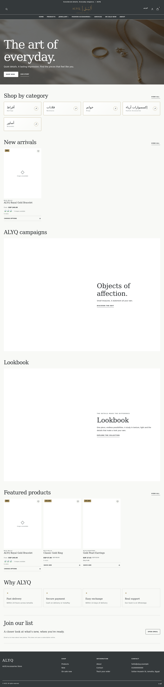 | 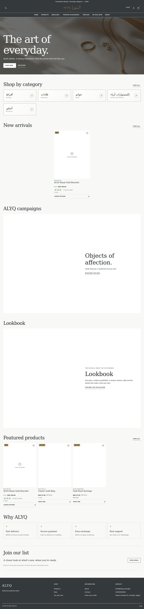 |

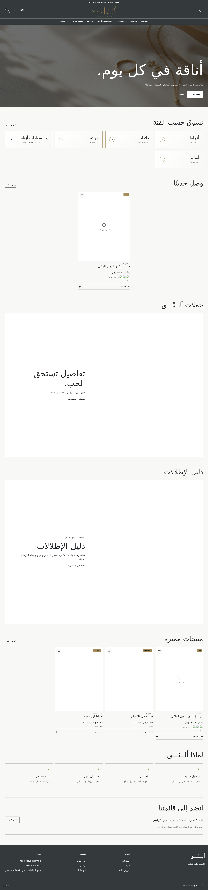

**النتيجة:** CTA رئيسي مترجم يفتح قائمة المنتجات المنشورة (`#/store/products`)؛ لا فيديو ولا صورة مولّدة ولا إعادة لعبارة `THE ALYQ EDIT`.

### 2. بطاقات المنتجات

| Before — EN | After — EN |
|---|---|
| 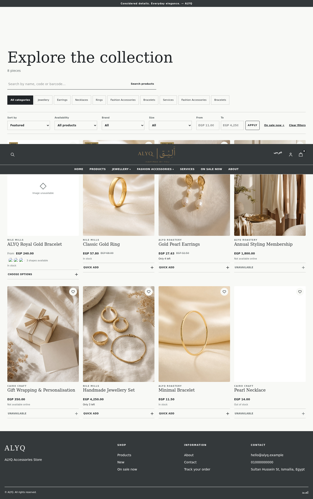 | 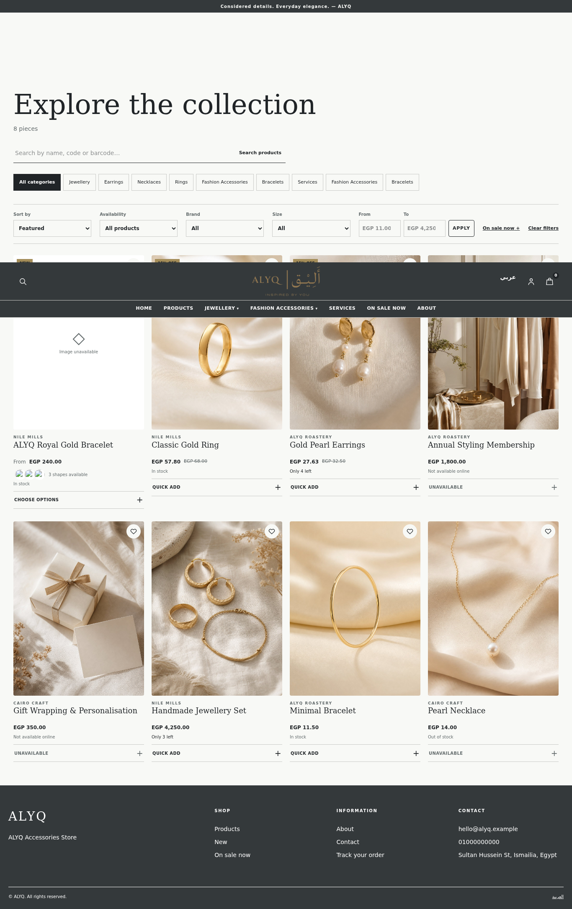 |

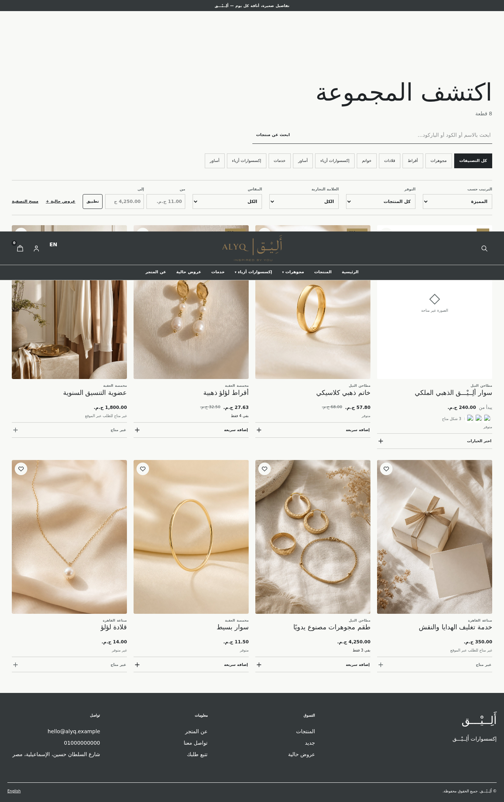

**النتيجة:** اسم وسعر وتوفر وعدد موديلات حقيقي؛ صور غير مهمة lazy؛ fallback محايد عند تعذر الصورة. لم تتغير بيانات المنتجات.

### 3. معرض الموديلات

| Before — EN | After — EN |
|---|---|
|  | 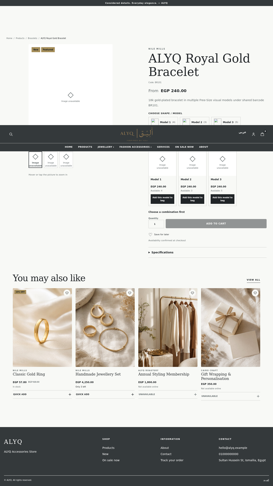 |

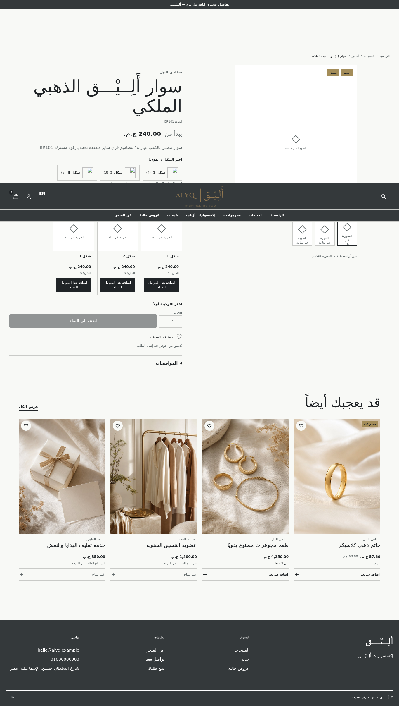

**النتيجة المختبرة:** الموديلات الثلاثة الحقيقية لـBR101 مع المخزون 4/3/5، واختيار الموديل يحافظ على UUID وSKU الفعليين وسعر المنتج الأب، ثم يصل إلى السلة وطلب العرض المحلي من دون استبدال موديل. لا توجد إضافة لموديل غير متوفر.

### 4. بطاقات الفئات النصية

| Before — EN | After — EN |
|---|---|
|  | 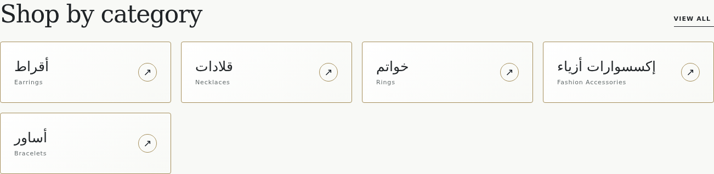 |

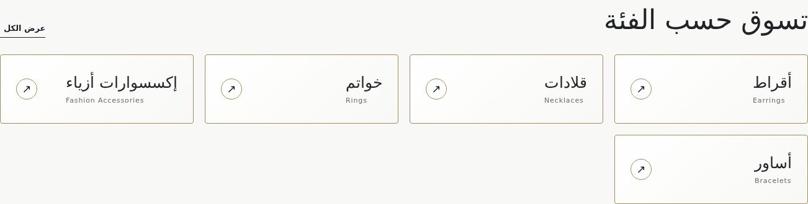

**النتيجة:** بطاقات نصية بلا صور أو تعديل أسماء/بيانات، مع احترام RTL/LTR وحالة النشر والأرشفة.

### 5. Mini Cart Drawer

| Before — EN | After — EN |
|---|---|
| 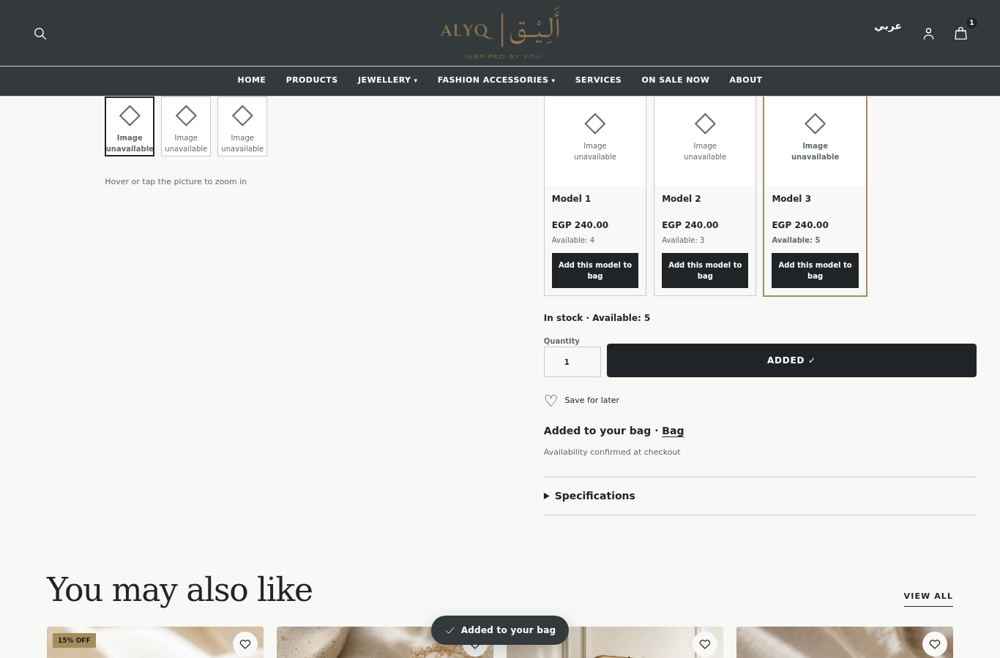 | 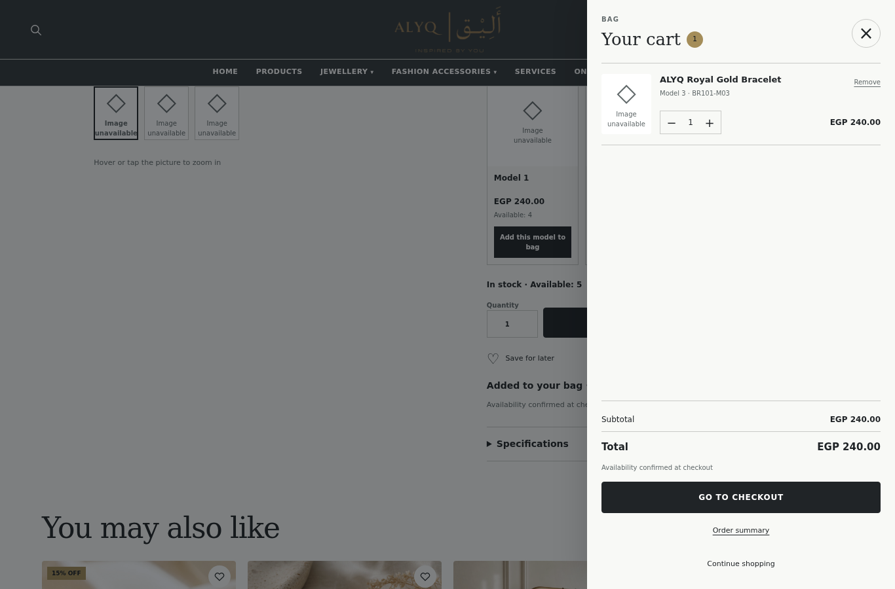 |

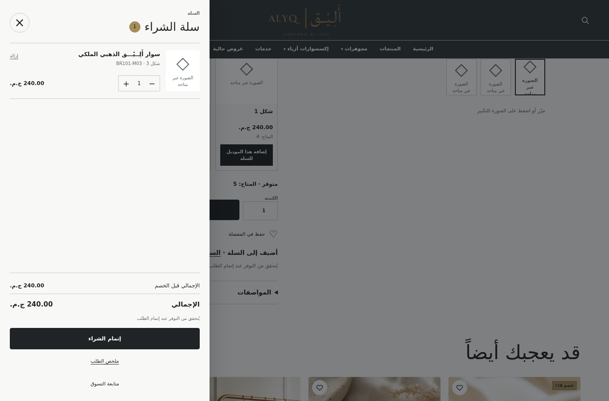

**النتيجة المختبرة:** drawer على `StoreCartProvider` نفسه، يعرض الموديل والسعر والكمية والتعديل والحذف والإجمالي؛ اختبارات E2E تحققت من إدارة التركيز، الحبس، Escape، إعادته، و`inert`/`aria-hidden` للخلفية.

### 6. تجربة الموبايل وشريط الشراء

| Before — EN · 390px | After — EN · 390px |
|---|---|
| 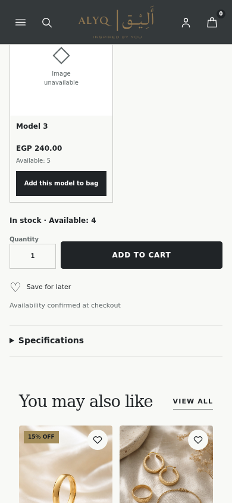 | 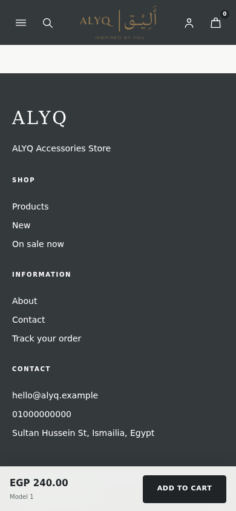 |

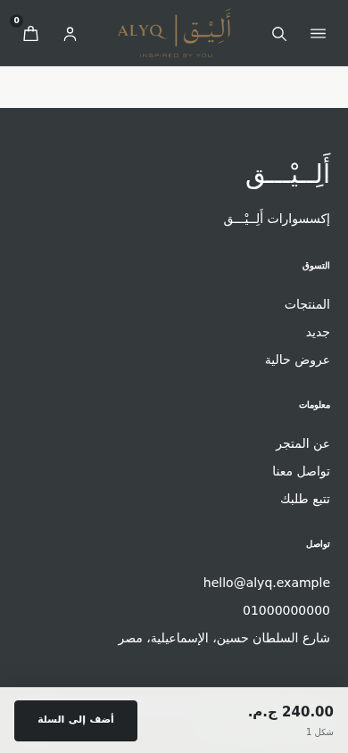

**النتيجة المختبرة:** الشريط الثابت يظهر في صفحة المنتج فقط، يعكس السعر/الموديل المحدد، يتوقف عند نفاد المخزون، ويحترم Safe Area؛ اختُبر اختفاؤه عند فتح الـDrawer وعارض الصور.

### 7. New Arrivals

| Before — EN | After — EN |
|---|---|
| 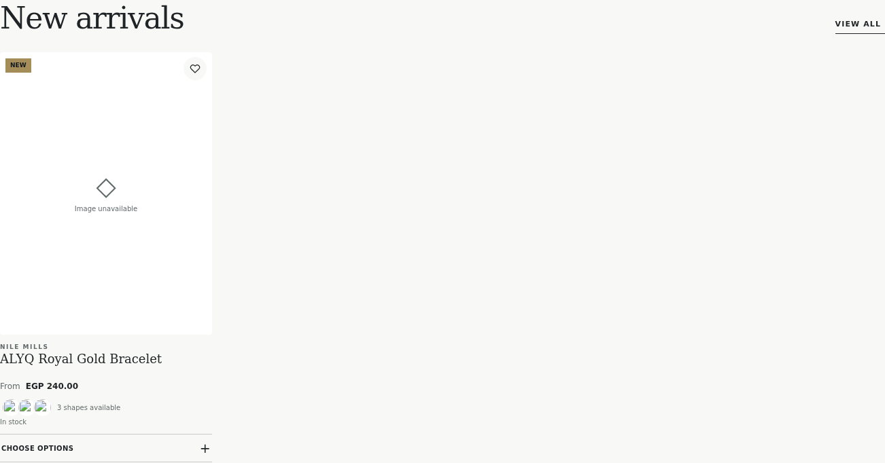 | 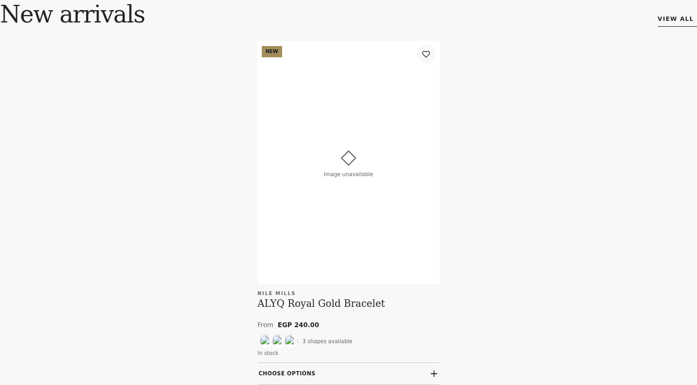 |

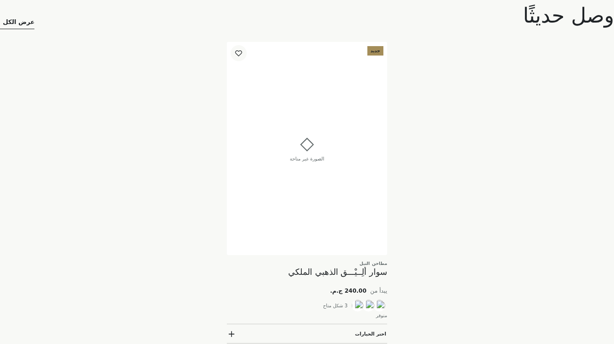

**النتيجة المختبرة:** المنتج المنشور الوحيد المتاح حاليًا لم يتكرر، وصار متمركزًا ومتوازنًا. **لم يتوفر في لقطة Staging سوى منتج واحد مؤهل**؛ لذا لم أُنشئ بيانات وهمية، وتنسيق حالتي المنتجين أو الثلاثة غير مُختبر فعليًا.

## جدول القبول

| البند | الحالة | الدليل / الملاحظة |
|---|---|---|
| Hero وCTA عربي/إنجليزي | ناجح | E2E يثبت الرابط المترجم؛ صور Home أعلاه |
| Product Cards والـfallback | ناجح | E2E، لقطة Catalog؛ الصور البعيدة محجوبة في Chromium |
| معرض الموديلات واستمرار الاختيار إلى السلة | ناجح | 63 فحصًا؛ UUID/SKU/المخزون وM03 في طلب محلي تجريبي |
| فئات نصية بلا صور | ناجح | E2E ولقطات EN/AR؛ لا فئة مؤرشفة أُعيدت |
| Mini Cart وسهولة الوصول | ناجح | E2E للكمية والحذف والإجمالي والتركيز وEscape؛ لقطات EN/AR |
| Responsive بلا تمرير أفقي | ناجح | Chromium: 360، 390، 768، 1366، 1920px؛ EN وAR |
| شريط شراء الموبايل وعدم التداخل | ناجح | Chromium: ظهر على صفحة المنتج فقط، واختفى مع الـDrawer والـLightbox |
| New Arrivals — منتج واحد مؤهل | ناجح | اختُبر عدم التكرار والتمركز والأهلية والنشر |
| New Arrivals — تكوين منتجين/ثلاثة | لم يُختبر | لا توجد هذه الكمية من المنتجات المؤهلة؛ لم تُضف بيانات تجريبية |
| Checkout على Staging فعليًا | لم يُختبر | فحص محلي تجريبي فقط؛ لم يُرسل بيع أو طلب إلى Staging |
| تفاعل لمس على جهاز فعلي | لم يُختبر | اختبارات Chromium responsive ونقر المتصفح، لا جهاز مادي |

## التحقق التقني

- `npm run build` — ناجح.
- `npm run typecheck` — ناجح.
- ESLint للملفات المعدّلة في المتجر والاختبار — ناجح.
- `npm run test:e2e -- storefront-v2` — **63/63 ناجح**. ظهرت تحذيرات jsdom المعروفة حول `window.scrollTo`، ولم تفشل أي حالة.
- Chromium — EN/AR، هاتف/سطح مكتب، وقياس overflow للأبعاد الخمسة أعلاه — ناجح.
- `git diff --check` — ناجح.
- لم تُشغّل حزمة CI الكاملة في هذا التسليم؛ لا يُدّعى نجاحها. توجد إخفاقات E2E تاريخية في CI خارج هذه المجموعة المستهدفة.

**السلامة والنطاق:** لم يُجرَ تعديل Staging أو Production أو Supabase أو المخزون أو المنتجات أو الفئات؛ لم يُنشأ حجز جديد، ولم تُترك عملية بيع معلقة من هذا الاختبار. الحجز التاريخي `WEB-000005` بقي خارج نطاق العمل ولم ألمسه. لم يُنشر Vercel Production، ولم يُبنَ EXE، ولم يُنشأ Commit في هذه المرحلة.
